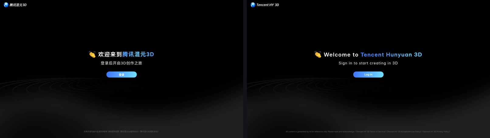
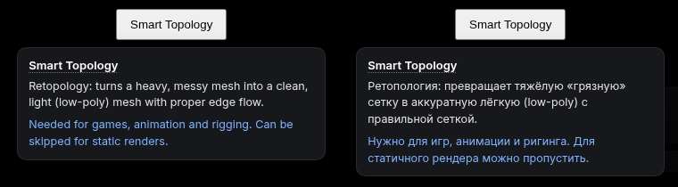

# Hunyuan 3D in English — Chrome extension (English UI & tooltips)

**English** · [Русский](#русский) · [Website](https://orybakov.github.io/hunyuan3d-english-ui/) · [Download](../../releases/latest)

Free, unofficial Chrome extension for [Tencent Hunyuan 3D](https://3d.hunyuan.tencent.com) (`3d.hunyuan.tencent.com`, Tencent HY 3D).
The Chinese site has no language switch, and `?lang=en` doesn't work. This extension translates the **whole
interface into English**, Studio included, fixes Tencent's awkward wording and adds tooltips that explain 3D settings.
**Hunyuan 3D на английском, с подсказками на русском**: see [Русский](#русский).

Tooltip demo (test button on the login page): English and Russian. Inside the app, tooltips appear on real buttons and settings.

## Features

- **English everywhere.** The site already ships Tencent's own English translation (used on the international
  site), but never lets you pick it. The extension turns it on before the app starts, both on the main site and
  in the separate **Studio** app (`/studio/...`). No flashes of Chinese, nothing in the app's logic is changed.
- **Better English.** ~620 fixes over Tencent's translation: mistranslations (*"Degreasing treatment"* →
  *"Remove Baked Lighting"*, *"Bone Binding"* → *"Rigging & Skinning"*), Chinglish (*"Copy Success"* → *"Copied"*),
  consistent terminology and shorter button labels.
- **Leftovers translated too.** Hard-coded strings, login dialog, UI-kit texts and server messages go through
  a ~1,900-entry dictionary; anything else is translated by Chrome's built-in **on-device** Translator
  (nothing is sent to third-party servers) and cached.
- **Tooltips for 3D terms** — face count, retopology, quads vs triangles, baked normals, UV, PBR, rigging,
  motion, component split, seed, export formats, etc.: what it is and what to choose.
  Terms with a tooltip have a dotted underline. Tooltips are in **English or Russian**, picked from your browser
  language. **Alt+H** — show/hide tooltips, **Alt+L** — switch tooltip language.
- **Neater look, same design.** Inter font for Latin/Cyrillic (the site expects *PingFang SC*, missing on
  Windows/Linux), no words broken mid-line, thin dark scrollbars, full text on hover for truncated labels.
- Text you type (prompts, inputs) is never touched.

## Install

1. Download the repo: **Code → Download ZIP** (or the zip from [Releases](../../releases)) and unpack it.
2. Open `chrome://extensions`, enable **Developer mode** (top right).
3. Click **Load unpacked** and select the unpacked folder (the one with `manifest.json`).
4. Open or reload https://3d.hunyuan.tencent.com.

Works in Chrome and other Chromium browsers (Edge, Brave, Yandex Browser). The fallback machine translator
needs Chrome's Translator API (Chrome 138+); it downloads a language model after your first click on the page.
Without it, everything else still works.

## Troubleshooting

Open DevTools (F12) → Console (context **top**):

- `__hyru.stats()` — status. `bundlePatched: true` means the built-in English is active
  (`forcedLng: "en"` in Studio). `mtState: "ready"` means the on-device translator works.
- `__hyru.missing()` — Chinese strings that are not in the dictionary. Please paste them into an issue.

## How it works

| File | What it does |
|---|---|
| `src/i18n-hook.js` | Main app: intercepts `JSON.parse` of the i18n bundles and copies English values into the Chinese bundle. Studio: forces `lng: "en"` in `i18next.init` via a short-lived `defaultNS` getter. Applies `overrides.js`. |
| `src/dom-translate.js` | MutationObserver-based translation of remaining text and attributes: dictionary → `{{placeholder}}` patterns → Chrome Translator API with a localStorage cache. |
| `src/hints.js`, `src/theme.css` | Tooltips (texts in `tools/hints_en.json`, `tools/hints_ru.json`), Alt+H / Alt+L, titles for truncated labels; font and small style fixes. |
| `tools/build_dict.py` | Rebuilds `src/dict.js`, `src/overrides.js`, `src/hints-data.js` from the live site plus `tools/*.json`. |
| `tools/smoke.mjs` | Headless Chrome smoke test via CDP, injects scripts the same way the extension does. |

After the site updates: `python3 tools/build_dict.py` (needs Python 3 and Node 18+), then reload the extension.
Want tooltips in another language? Add `tools/hints_<lang>.json` with the same keys and the language to `build_dict.py` / `hints.js` — PRs welcome.
Edit wording in `tools/overrides_en.json` (by i18n key) or `tools/manual_zh_en.json` (by Chinese text).

## Known limitations

- Pages behind login were tested by a real user, not by the automated smoke test (the site requires a Chinese-ecosystem login).
- Text baked into images (banners, the login illustration) cannot be translated.
- The international site `3d.hunyuanglobal.com` is not supported: it has native English, but blocked us from
  both Russian and EU hosting IPs.

## Disclaimer & license

Not affiliated with or endorsed by Tencent. "Hunyuan" and "Tencent" are trademarks of their owners.
Code: [MIT](LICENSE). Font: [Inter](https://rsms.me/inter/), SIL Open Font License 1.1 (`fonts/LICENSE.txt`).

---

## Русский

**Hunyuan 3D на английском, с подсказками на русском.** Бесплатное неофициальное расширение Chrome для [Tencent Hunyuan 3D](https://3d.hunyuan.tencent.com).
Китайский сайт — тот, что реально открывается из России, но интерфейс у него только на китайском.
Расширение переводит его на английский, исправляет кривые формулировки и добавляет подсказки к 3D-терминам на русском (или английском).

### Что умеет

- **Английский везде** — включает родной английский перевод Tencent (на основном сайте и в Studio `/studio/...`) до загрузки приложения, без мелькания китайского.
- **Нормальный английский** — около 620 исправлений: ошибки перевода, «Chinglish», единые термины, короткие кнопки.
- **Остатки** — словарь на ~1900 строк, а что не нашлось — встроенный в Chrome офлайн-переводчик (ничего не уходит на сторонние серверы).
- **Подсказки на русском и английском** к ~70 терминам: полигоны, ретопология, quads/triangles, запекание нормалей, UV, PBR, риг, анимация, разделение на части, seed, форматы экспорта — что это и что выбирать. Язык берётся из языка браузера. Термины с подсказкой подчёркнуты пунктиром. **Alt+H** — вкл/выкл, **Alt+L** — сменить язык подсказок.
- **Аккуратнее, дизайн тот же** — шрифт Inter, слова не рвутся посередине, тонкие скроллбары, полный текст у обрезанных надписей.
- Поля ввода (промпты) не трогает.

### Установка

1. **Code → Download ZIP** (или zip из [Releases](../../releases)), распаковать.
2. `chrome://extensions` → включить **Режим разработчика**.
3. **Загрузить распакованное расширение** → выбрать папку с `manifest.json`.
4. Открыть или обновить https://3d.hunyuan.tencent.com.

Подходит для Chrome, Edge, Brave, Яндекс Браузера. Офлайн-переводчику нужен Chrome 138+, модель он скачает после первого клика по странице; без него остальное работает.

### Если что-то не переведено

F12 → Console (контекст **top**): `__hyru.stats()` — состояние, `__hyru.missing()` — строки, которых нет в словаре. Пришлите их в Issues.

### Ограничения

- Не связано с Tencent. Картинки с китайским текстом не переводятся.
- Международная версия `3d.hunyuanglobal.com` не поддерживается — она блокирует российские IP и IP хостингов/VPN.
